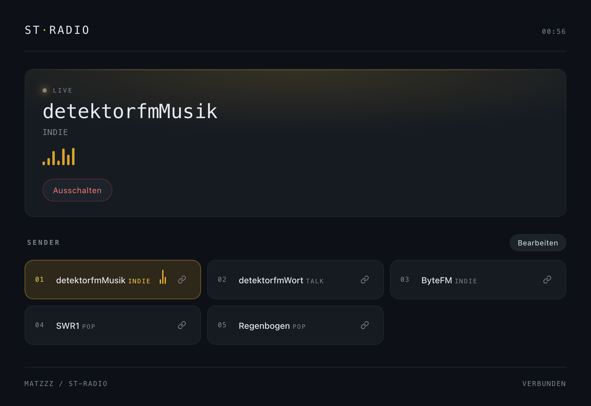
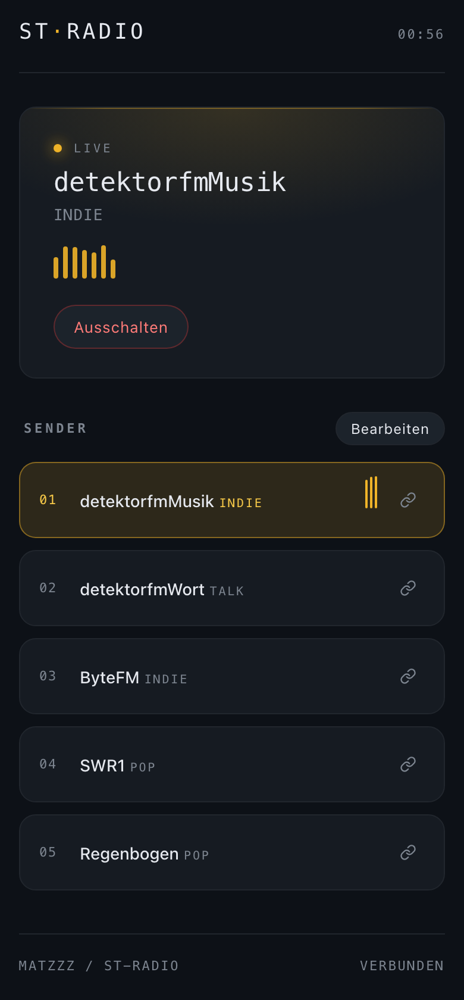

# mare-radio

🇬🇧 [English version](README.en.md)

Moderne Neuauflage des Pi-Webradios von [matzZz/st-radio](https://github.com/matzZz/st-radio).

<p>
  
  &nbsp;
  
</p>

## Was sich geändert hat

| Vorher                                      | Jetzt                                        |
| ------------------------------------------- | -------------------------------------------- |
| HTML 4.01 + Tabellen-Layout + Inline-Styles | HTML5 + CSS Custom Properties + Grid         |
| Full Page Reload bei jedem Klick            | JSON-API + `fetch()` ohne Reload             |
| `$_GET['name']` floss bis in `exec()`       | Whitelist per ID, `escapeshellarg()`, kein User-String in Shell |
| Manuelles CSV-Parsing per `explode`         | `fgetcsv()` mit Header-Erkennung             |
| Kein Statusabgleich                         | PID-File + Status-Endpoint, Polling alle 5 s |
| `apache2` als `pi` (in der alten README)    | Standard `www-data`, sudoers-Eintrag empfohlen (s. u.) |

## Dateien

- `index.html` – Single-Page-Oberfläche
- `api.php` – JSON-API (`stations`, `status`, `play`, `stop`, `save`)
- `radio.sh` – startet `mpv` mit der Stream-URL und gibt dessen PID aus
- `ruhe.sh` – beendet `mpv`
- `radio.php`, `ruhe.php` – Kompatibilität für alte Links (s. u.)
- `radio.csv` – Senderliste: `name;url;genre;slug` (Header-Zeile optional)

## Setup

```sh
sudo apt-get install mpv apache2 php php-mbstring php-xml
# Projektdateien nach /var/www/html/ kopieren
sudo chown -R www-data:www-data /var/www/html
sudo chmod +x /var/www/html/radio.sh /var/www/html/ruhe.sh
```

Standardmäßig läuft Apache als `www-data` – belass es dabei (das alte Setup mit `pi` als Apache-User war praktisch, aber unsicher). Damit `www-data` `mpv` starten darf, reicht das so, weil `mpv` keine Root-Rechte braucht. Falls Audio nicht rauskommt, prüfe Gruppenmitgliedschaft:

```sh
sudo usermod -aG audio www-data
```

## Sprache

Die Oberfläche gibt es auf Deutsch und Englisch. Umschalten oben rechts über **DE | EN** – die Wahl merkt sich der Browser. Beim ersten Besuch gilt die Browsersprache (Englisch bei englischem Browser, sonst Deutsch). Per Link geht es auch direkt: `http://<pi>/?lang=en`.

Die API liefert Fehlermeldungen standardmäßig auf Deutsch, mit `&lang=en` auf Englisch.

## Hell / Dunkel

Oben rechts schaltet der Sonne/Mond-Knopf zwischen hellem und dunklem Modus um – auch das merkt sich der Browser. Beim ersten Besuch gilt die Systemeinstellung des Geräts.

## Titelanzeige

Viele Sender schicken im Stream mit, was gerade läuft (ICY-Metadaten). mpv liest das mit, `api.php` holt es sich über den IPC-Socket von mpv (`/tmp/st-radio-mpv.sock`, siehe `radio.sh`) und liefert es bei `action=status` als `track` mit:

```json
{"playing": true, "station": {…}, "track": {"title": "Only time / Enya"}}
```

Die Oberfläche zeigt den Titel unter dem Sendernamen. Schickt ein Sender im Stream nur seinen eigenen Namen, bleibt die Zeile leer (`track: null`). Nach einem Senderwechsel kann es ein paar Sekunden dauern, bis der erste Titel da ist.

## Podcasts

Podcasts stehen in derselben Senderliste: Im Editor statt einer Stream-URL einfach die **RSS-Feed-Adresse** eintragen. Beim Speichern erkennt `api.php`, dass es ein Feed ist, und vermerkt das in `radio.csv` (Spalte 5 `type` = `podcast`). In der Oberfläche erscheinen Podcasts in einem eigenen Bereich unter den Radiosendern.

- **Klick auf die Karte** spielt die neueste Folge (jüngstes `pubDate` im Feed) – und setzt dort fort, wo man aufgehört hat.
- Ist eine Folge angefangen, zeigt die Karte z.B. „12:34 gehört“ und zwei Symbole: **▶** fortsetzen, **↺** von vorn.
- Am Ende einer Folge stoppt die Wiedergabe; die Folge gilt dann als gehört und startet beim nächsten Klick von vorn – bis eine neue Folge erscheint.
- Die Position merkt sich `api.php` beim Stoppen, beim Senderwechsel und laufend, solange die Oberfläche offen ist (`.podcast-positions.json`). Feeds werden 30 Minuten zwischengespeichert.
- Per Link: `api.php?action=play&slug=<podcast>&from=resume` setzt fort (auch ohne `from`), `&from=start` startet die neueste Folge von vorn. Das Link-Symbol auf der Podcast-Karte bietet beide Varianten zum Kopieren an.

Zum Lesen der Feeds braucht PHP die XML-Erweiterung (`php-xml`, siehe Setup).

## Sicherheit

Die alte Version hat den HTTP-Parameter `name` in einen Shell-Aufruf weitergegeben. Diese Version macht das anders:

1. Der Client schickt nur eine numerische **ID**.
2. Die ID wird in `radio.csv` nachgeschlagen.
3. Nur die in der CSV stehende URL wandert nach `radio.sh` – und dort durch `escapeshellarg()`.

Damit gibt es keinen Pfad mehr, über den ein Webrequest direkt eine beliebige Shell-Anweisung auf dem Pi auslösen könnte.

Bei Podcasts wird ebenfalls nur die Feed-URL aus `radio.csv` abgerufen. Die Audio-Adresse der Folge kommt aus dem Feed, muss `http(s)` sein und geht genauso escaped an `radio.sh`.

## Senderpflege

Am einfachsten im Browser: In der Oberfläche auf **Bearbeiten** klicken – dort lassen sich Sender hinzufügen, umbenennen, verschieben und löschen. Beim Speichern prüft `api.php` die Eingaben (Name Pflicht und eindeutig, nur `http://`/`https://`-URLs) und legt die vorherige Liste als `radio.csv.bak` ab.

Alternativ von Hand: `radio.csv` ist semikolon-getrennt:

```
name;url;genre;slug
SWR3;https://liveradio.swr.de/sw282p3/swr3/play.mp3;Pop;swr3
```

Eine Header-Zeile (`name;…`) wird erkannt und übersprungen.

Jeder Sender hat einen festen **Slug** (Spalte 4). Er wird beim Anlegen einmal aus dem Namen gebildet (z.B. `SWR3` → `swr3`, `detektor.fm Wort` → `detektor-fm-wort`) und bleibt danach gleich – auch wenn du den Sender im Editor umbenennst. Fehlt die Spalte (ältere `radio.csv`), wird der Slug aus dem Namen abgeleitet und beim nächsten Speichern festgeschrieben. Den Slug brauchst du für stabile Webhook-URLs (siehe nächster Abschnitt).

## Webhooks / Direkte Links

`play` und `stop` sind absichtlich auch per **GET-Request** erreichbar – damit du Sender per Webhook, Bookmarklet, Tasker, Homebridge, Home Assistant, Node-RED, Shortcut oder einem simplen Browser-Lesezeichen starten kannst:

```
http://<pi>/api.php?action=play&slug=swr3
http://<pi>/api.php?action=play&slug=deutschlandfunk
http://<pi>/api.php?action=play&id=3
http://<pi>/api.php?action=stop
```

**Slug oder ID?** Nimm den **Slug**, wenn du die URL irgendwo speicherst – der bleibt stabil, auch wenn du Sender umsortierst oder umbenennst. Die ID ist nur die Zeilennummer und verschiebt sich beim Umsortieren.

Antwort ist JSON (HTTP 200 bei Erfolg, 404 wenn der Sender nicht in der CSV steht). Wenn du den Link direkt im Browser anklickst und nicht JSON, sondern das UI sehen willst, hänge `&redirect=1` an:

```
http://<pi>/api.php?action=play&slug=swr3&redirect=1
```

In der Web-Oberfläche hast du neben jedem Sender ein kleines Link-Symbol – ein Klick kopiert die passende Webhook-URL in die Zwischenablage.

## Alte Links (Upgrade von st-radio)

Wer vom alten st-radio kommt, kann bestehende Aufrufe (z.B. Shelly-Actions, Homebridge) unverändert lassen:

```
http://<pi>/radio.php?name=2   → wie api.php?action=play&id=2
http://<pi>/ruhe.php           → wie api.php?action=stop
```

Beide leiten danach auf `index.html` weiter. Die Reihenfolge in `radio.csv` muss dafür gleich bleiben (die Header-Zeile zählt nicht mit).

Läuft Apache aus dem alten Setup noch als `pi`, kann das so bleiben – das Webverzeichnis muss dann `pi` gehören (`sudo chown -R pi:pi /var/www/html`), damit `api.php` die Statusdatei schreiben kann.
